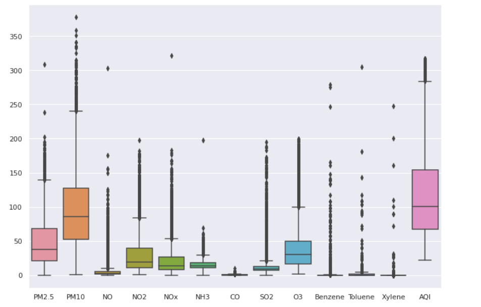
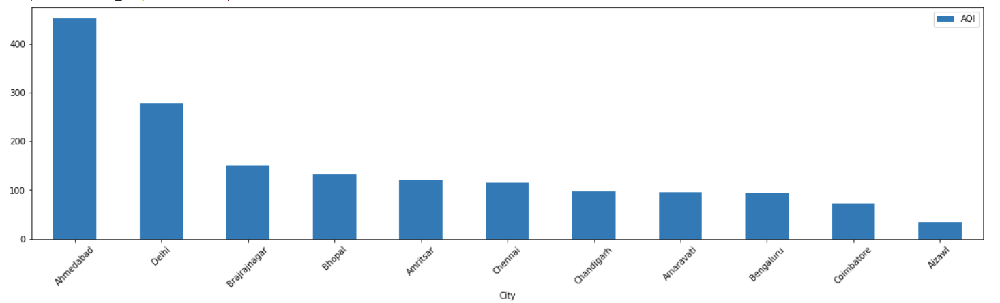
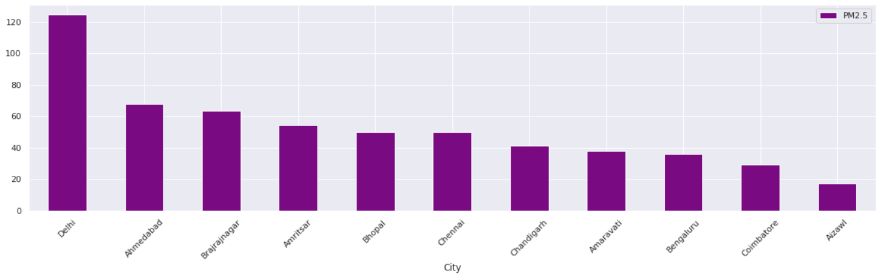
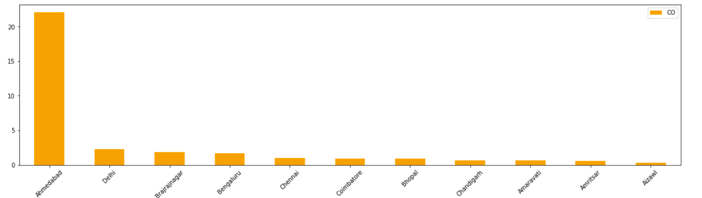
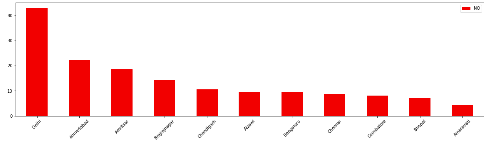
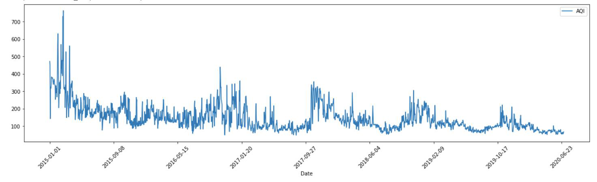
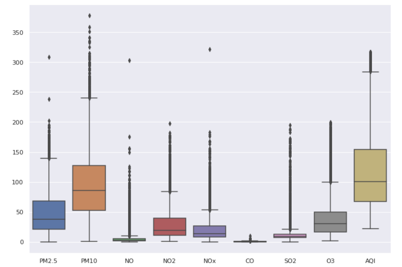
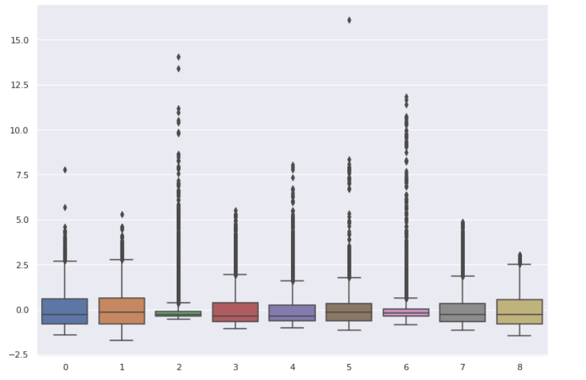
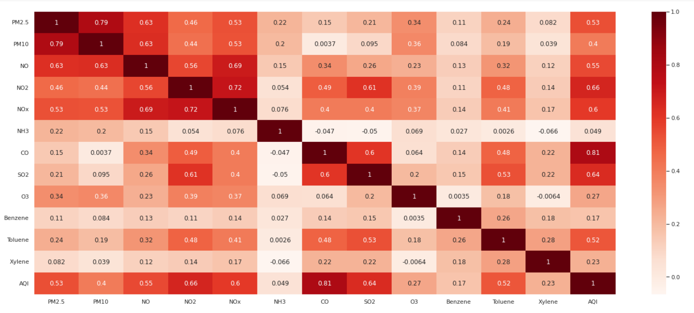

# Predicting the Air Quality Index of Indian Cities

*Term Project I, Virginia Tech Certificate Program in Business Analytics and AI, Alexandria cohort 2021–22. Submitted March 2022.*

## 1. Objective

The Air Quality Index (AQI) is a daily scale for reporting how polluted the air is and what that means for health. Using a dataset of AQI and pollutant levels for Indian cities over time, this project explores the data, cleans and transforms it, then builds and compares several models that predict AQI from pollutant readings, repeated across each of the datasets provided.

## 2. Domain

The AQI reports air quality on a daily basis: how pollution is likely to affect health within a short period. The higher the AQI, the more polluted the air and the greater the health concern. Government agencies use it to tell the public how polluted the air is now or is forecast to become, and many developed countries have used it for over three decades.

The US Environmental Protection Agency calculates AQI from five major pollutants: ground-level ozone, particulate matter (PM2.5 and PM10), carbon monoxide, sulfur dioxide and nitrogen dioxide. Each country has its own index, tied to its national air quality standards. India's AQI covers the eight pollutants with National Ambient Air Quality Standards: PM10, PM2.5, NO₂, SO₂, CO, ground-level ozone, ammonia and lead.

## 3. Data

The dataset contains AQI and pollutant readings at hourly and daily levels, from monitoring stations in multiple Indian cities between 2015 and 2020. It has five tables:

| Table | Grain |
| --- | --- |
| City data | Daily |
| City data | Hourly |
| Station data | Daily |
| Station data | Hourly |
| Station info | Reference (each city has several stations, each with a unique ID) |

**Cities (26):** Ahmedabad, Aizawl, Amaravati, Amritsar, Bengaluru, Bhopal, Brajrajnagar, Chandigarh, Chennai, Coimbatore, Delhi, Ernakulam, Gurugram, Guwahati, Hyderabad, Jaipur, Jorapokhar, Kochi, Kolkata, Lucknow, Mumbai, Patna, Shillong, Talcher, Thiruvananthapuram and Visakhapatnam.

**Fields:** PM2.5, PM10, NO, NO₂, NOx, NH₃, CO, SO₂, O₃, benzene, toluene, xylene, AQI and AQI bucket.

## 4. Exploratory analysis

### Descriptive statistics (city, daily)

| Field | Count | Mean | Std. dev. | Min | Median | Max |
| --- | --- | --- | --- | --- | --- | --- |
| PM2.5 | 10,394 | 59.6 | 52.3 | 0.16 | 44.9 | 868.7 |
| PM10 | 7,639 | 120.5 | 95.4 | 0.21 | 93.9 | 917.1 |
| NO | 10,581 | 16.7 | 22.3 | 0.02 | 10.0 | 390.7 |
| NO₂ | 10,684 | 30.7 | 27.9 | 0.02 | 21.3 | 292.0 |
| NOx | 10,523 | 30.7 | 28.9 | 0.00 | 22.0 | 382.8 |
| NH₃ | 8,545 | 32.3 | 33.5 | 0.02 | 23.3 | 352.9 |
| CO | 10,713 | 4.07 | 10.7 | 0.00 | 0.93 | 175.8 |
| SO₂ | 10,463 | 15.7 | 22.0 | 0.48 | 8.85 | 186.1 |
| O₃ | 10,337 | 34.8 | 22.2 | 0.01 | 31.1 | 257.7 |
| Benzene | 9,909 | 3.34 | 12.0 | 0.00 | 1.15 | 391.9 |
| Toluene | 9,331 | 8.85 | 18.2 | 0.00 | 2.21 | 411.5 |
| Xylene | 4,201 | 3.94 | 7.39 | 0.00 | 1.48 | 137.5 |
| AQI | 10,293 | 176.6 | 178.2 | 18 | 112 | 2,049 |

The most common AQI bucket is *Satisfactory* (3,748 of 10,293 days).

### Pollutant distributions

### City rankings

Data was aggregated by city and ranked by each pollutant.

Ahmedabad has the highest mean AQI and CO, and Delhi the highest PM2.5 and NO.

### AQI over time

AQI is cyclic: it peaks every winter.

## 5. Data preparation

### Missing values

| Field | Missing | Field | Missing |
| --- | --- | --- | --- |
| PM2.5 | 1,299 | SO₂ | 1,230 |
| PM10 | 4,054 | O₃ | 1,356 |
| NO | 1,112 | Benzene | 1,784 |
| NO₂ | 1,009 | Toluene | 2,362 |
| NOx | 1,170 | Xylene | 7,492 |
| NH₃ | 3,148 | AQI | 1,400 |
| CO | 980 | AQI bucket | 1,400 |

AQI is the prediction target, so rows without it were dropped. Missing values in other columns were filled with the column median.

### Scaling

Features were standardized with `StandardScaler().fit_transform()` to make modeling faster and less computationally intensive.

| Before scaling | After scaling |
| --- | --- |
|  |  |

### Correlation analysis

The correlation coefficient is covariance normalized by the two standard deviations, ρ = cov(X, Y) / (σX σY). It ranges from −1 to 1: positive when two variables rise together, negative when one falls as the other rises, and near zero when they're unrelated.

- **AQI correlates most strongly with CO (0.81),** followed by NO₂ (0.66), SO₂ (0.64), NOx (0.60), NO (0.55), PM2.5 (0.53) and PM10 (0.40).
- The other features correlate only weakly with AQI.
- PM2.5, PM10, NO, NO₂ and NOx are strongly correlated with each other.
- Benzene and toluene are also correlated with each other.

## 6. Modeling

Models were built with scikit-learn: linear regression, logistic regression, decision tree regressor, support vector machine (SVC) and Gaussian Naive Bayes. Each was scored at three train/test splits (80/20, 70/30 and 60/40) on all four datasets. Only the features most correlated with AQI were used: PM2.5, PM10, NO, NO₂, NOx, CO, SO₂ and O₃.

### Scores

**City, daily**

| Split | Linear regression | Logistic regression | Decision tree | SVC | Gaussian NB |
| --- | --- | --- | --- | --- | --- |
| 80/20 | 0.99978 | 0.01457 | 0.99927 | 0.02477 | 0.32880 |
| 70/30 | 0.99995 | 0.01878 | 0.99978 | 0.02396 | 0.03044 |
| 60/40 | 0.99837 | 0.01773 | 0.99795 | 0.02234 | 0.15736 |

**City, hourly**

| Split | Linear regression | Logistic regression | Decision tree | SVC | Gaussian NB |
| --- | --- | --- | --- | --- | --- |
| 80/20 | 0.99834 | 0.06653 | 0.99843 | 0.06793 | 0.03081 |
| 70/30 | 0.99098 | 0.07283 | 0.99265 | 0.07750 | 0.01821 |
| 60/40 | 0.99246 | 0.07318 | 0.99243 | 0.07948 | 0.01296 |

**Station, hourly**

| Split | Linear regression | Logistic regression | Decision tree | SVC | Gaussian NB |
| --- | --- | --- | --- | --- | --- |
| 80/20 | 0.99984 | 0.06263 | 0.99981 | 0.07752 | 0.41427 |
| 70/30 | 0.99985 | 0.05818 | 0.99982 | 0.07255 | 0.39562 |
| 60/40 | 0.99989 | 0.05929 | 0.99987 | 0.06879 | 0.62346 |

**Station, daily**

| Split | Linear regression | Logistic regression | Decision tree | SVC | Gaussian NB |
| --- | --- | --- | --- | --- | --- |
| 80/20 | 0.99827 | 0.01418 | 0.99829 | 0.01276 | 0.14036 |
| 70/30 | 0.99923 | 0.01512 | 0.99922 | 0.01197 | 0.09672 |
| 60/40 | 0.99949 | 0.01607 | 0.99949 | 0.01182 | 0.11132 |

Only linear regression and the decision tree regressor gave good results, scoring consistently high on every dataset and split. Logistic regression didn't converge within the standard iteration limit, and the classifiers aren't suited to a continuous target.

### Model choice

Linear regression and the decision tree scored about the same. **Linear regression was chosen** because it trained much faster: about 3–4 seconds against roughly 60 seconds for the decision tree.

**Note:** AQI is calculated from these same pollutant concentrations, so near-perfect scores are expected from a model that predicts it from them. They show that the pipeline is consistent, not that the model would forecast AQI ahead of time.

## 7. Limitations of linear regression

- **It assumes linear relationships.** That holds here, but it would fail on non-linear systems.
- **It models only the mean of the target,** so it isn't suited to predicting extreme values.
- **It is sensitive to outliers.**
- **It assumes independent observations.** Pollutant readings are only roughly independent, and are strongly correlated with each other in places.
